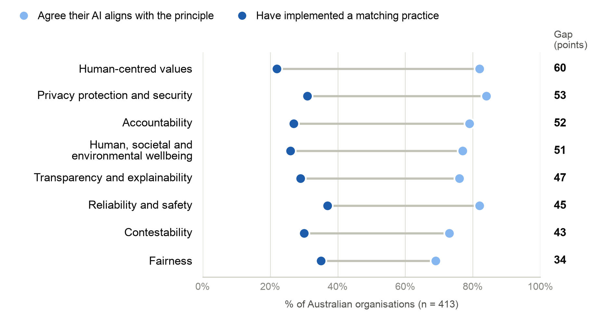

# Findings — Draft (revised Week 5)

**Topic 6:** What is the effectiveness of ethics guidelines and principles in practice?

---

## 2. Findings

### 2.1 Awareness without action

The cleanest test of a guideline is whether it changes the choices of the people building AI systems. McNamara et al. (2018) showed half of a group of 168 software engineering students and professionals the ACM Code of Ethics before giving everyone a set of ethical scenarios. They found no statistically significant difference on any scenario. Hagendorff (2020) treats this as evidence that the effect of guidelines is "almost zero" (p. 108), but that reading goes too far. The study tested a general professional code rather than an AI-specific one, used hypothetical vignettes, and exposed participants to the code only once. It shows that reading a code does not change decisions. It says little about guidelines that are built into training, reviews or management expectations.

Later research suggests that guidelines do reach practitioners but stall at that point. In a survey of 100 AI practitioners, Pant et al. (2024) found that most were reasonably familiar with AI ethics, mainly because of workplace rules and policies, although they rated formal education as only somewhat helpful in preparing them to apply it. Interviews tell a more complicated story. Sanderson et al. (2023) asked 21 CSIRO scientists and engineers how their work aligned with Australia's eight Principles. Fairness meant diverse training data to one participant and non-discrimination to another, transparency was usually collapsed into explainability, and accountability was sometimes disclaimed altogether: "Whether the [system] works in 10 years, it's not under our control" (Section IV-F). Drawing on 35 interviews and a survey of 267 practitioners, Holstein et al. (2019) similarly found a disconnect between the fairness problems teams actually faced and the solutions offered in research.

Part of the difficulty is that principles conflict. Whittlestone et al. (2019) argue that principles are "often too broad and high-level to guide ethics in practice" (p. 195), because they say nothing about what to do when, for example, accuracy competes with explainability. The 2026 AI Index reaches the same point from the technical side: gains in privacy can reduce fairness and gains in safety can reduce accuracy, yet "there is no framework for navigating these trade-offs" (Stanford Institute for Human-Centered Artificial Intelligence [Stanford HAI], 2026, p. 126). Guidelines succeed at creating awareness, but they leave the hardest decisions to individual developers.

### 2.2 Incentives over intentions

If practitioners know the principles but do not act on them, the literature consistently points to the organisation rather than the individual. Hagendorff (2020) argues that AI development follows an economic logic in which "speed is everything" and skipping ethics is "the path of least resistance" (p. 108). Studies inside technology companies support this. Ali et al. (2023) found that workers responsible for AI ethics operate in an environment where "policies, practices, and outcomes are decoupled" (p. 217). Ethics loses to product launch deadlines, is hard to express in the metrics that drive company goals, and is disrupted by constant reorganisation, so raising a concern becomes a personal risk. Rakova et al. (2021) interviewed 26 practitioners from 19 organisations and found that many organisations acted only reactively, most often after negative media attention, and that organisational incentives were frequently misaligned with responsible AI work. Media reports of Google dissolving its AI ethics council little more than a week after announcing it in 2019 (Piper, 2019), and of Microsoft laying off its Ethics and Society team in 2023 (Schiffer & Newton, 2023), are anecdotal, but they show how quickly ethics structures can disappear when they conflict with commercial priorities.

Australian survey data shows the same pattern at national scale. In the 2024 Responsible AI Index, 413 executives rated their AI against statements for each of the eight Principles and reported which related practices they had implemented (Figure 1). Agreement averaged 78% and implementation 29% (Fifth Quadrant, 2024). The gap was widest for human-centred values, where 82% claimed alignment but only 22% had assessed their AI's human rights risks.

**Figure 1**

*Self-Reported Alignment With Australia's AI Ethics Principles Compared With Implementation of a Matching Practice*

*Note.* Data from Fifth Quadrant (2024, p. 4); n = 413 Australian organisations.

The 2025 Index, which surveyed 418 organisations against the Voluntary AI Safety Standard, found little progress. The mean score fell from 44 to 43 out of 100, and only a third of organisations had adopted the Standard. Among the least implemented practices were designated roles for responsible AI (25%) and oversight measures for autonomous systems (23%), even though 58% of organisations rated their human control mechanisms highly (Fifth Quadrant, 2025). These are self-reported surveys by a commercial firm sponsored by the National AI Centre, so some caution is needed. However, self-reporting would normally overstate good practice, which makes the gap more telling.

The same data also shows where principles seem to work. Organisations in the most mature group had implemented around 32 of 45 practices, and 84% of them had the Principles in place, compared with 27% of the least mature (Fifth Quadrant, 2025). Global data is similar. In the AI Index's 2025 survey of organisations, the share with no responsible AI policy fell from 24% to 11%, and 8 percentage points more organisations than in 2024 said their policies had reduced AI incidents. Yet knowledge and training gaps, the most cited obstacle, rose from 51% to 59% (Stanford HAI, 2026, p. 144). This is correlation, not proof that principles cause good practice. It does fit the finding of Madaio et al. (2020), from co-design work with 48 practitioners, that checklists can provide "organizational infrastructure" (p. 1) for ad hoc processes and empower individual advocates. Principles appear to help where an organisation already has the leadership and structure to act on them.

### 2.3 From principles to practices

A third explanation is that principles are too abstract to act on. Morley et al. (2020) describe a debate focused on the "what" of AI ethics rather than the "how". Lu et al. (2024), writing from CSIRO, put it more sharply: without guidance on best practice, "practitioners are left with nothing much beyond truisms" (p. 1). A scoping review by Sadek et al. (2025) concludes that responsible AI guidelines "currently fail to impact practice" (p. 199) and traces this to five causes: abstract guidelines, conflicting values, success that is hard to measure, a fragmented development pipeline, and a lack of internal accountability.

Researchers have built tools to close this gap, such as internal audit frameworks that check decisions against an organisation's principles at each stage of development (Raji et al., 2020) and catalogues of governance and design patterns (Lu et al., 2024). These tools have limits of their own. Ayling and Chapman (2022) compared AI ethics tools with established impact assessment and audit practice from fields such as environmental, privacy and financial regulation, and found clear gaps in auditing and risk assessment. Mökander et al. (2021) show that even well-designed ethics-based auditing faces conceptual, technical, social, economic, organisational and institutional constraints. A tool is only as effective as an organisation's willingness to use it.

Australia's policy has moved in the direction this literature recommends. The 2019 Principles state values, while the 2025 Guidance prescribes actions. Several of its six practices target the barriers above. "Decide who is accountable" addresses the diffused responsibility found by Sanderson et al. (2023) and Sadek et al. (2025), and "test and monitor" turns reliability into something that can be checked. The difficulty is that the 2025 Index shows these are the very practices organisations are least likely to have adopted, with only 25% having designated roles for responsible AI (Fifth Quadrant, 2025). The Guidance is better designed than the Principles, but no independent evaluation yet shows that it changes behaviour, and clearer instructions do not remove the incentives described in Section 2.2.

### 2.4 Voluntary guidance and the limits of soft law

The final issue is whether voluntary guidance can work without consequences. Munn (2023) calls AI ethics principles "useless". He argues that they are contested, isolated from an industry and education system that largely ignores ethics, and "toothless", lacking consequences and adhering to "corporate agendas" (p. 869). Rességuier and Rodrigues (2020) make a subtler point: the problem is not ethics itself but its use "as a substitute for law", which "risks its abuse and misuse" (p. 1).

Australia's recent policy choices bring this debate into focus. In 2024 the government proposed mandatory guardrails for high-risk AI (DISR, 2024), and a Senate committee recommended "new, whole-of-economy, dedicated legislation to regulate high-risk uses of AI" (Senate Select Committee on Adopting Artificial Intelligence, 2024, Recommendation 1). Within a year the direction had reversed. The Productivity Commission argued, first in an interim report and then in its final report, that AI-specific regulation should be "a last resort" (Productivity Commission, 2025, Recommendation 1.2). The National AI Plan of December 2025 then chose to rely on existing, largely technology-neutral laws, voluntary guidance and a $30 million advisory AI Safety Institute (DISR, 2025b; Evans, 2025). The European Union went the other way. Its AI Act imposes binding obligations on high-risk systems, with fines of up to 7% of global annual turnover for the most serious breaches (Regulation 2024/1689).

The Productivity Commission's reasoning deserves attention because it complicates the case for regulation. It argued that the guardrails "regulate processes – risk management, testing, and transparency – rather than outcomes and thus do not directly prevent harm" (Productivity Commission, 2025, Box 1.7). That is a fair criticism, and it echoes Ali et al.'s (2023) finding that policies and outcomes can be decoupled. But it cuts both ways. If mandated processes cannot guarantee good outcomes, voluntary ones are even less likely to, and the Index data shows that most organisations do not follow them. Existing law can also be slow to respond. The Robodebt Royal Commission examined an automated debt-recovery scheme that operated unlawfully for years before it was stopped, and recommended a consistent legal framework for automated decision-making in government (Royal Commission into the Robodebt Scheme, 2023, Recommendation 17.1).

Evidence about outcomes, the level that matters most, is thin. The AI Incident Database recorded 362 incidents in 2025, up from 233 in 2024, and average transparency among leading foundation model developers fell from 58 to 40 out of 100 (Stanford HAI, 2026). Wider deployment and better reporting explain part of this rise, so these figures do not prove that guidelines have failed. They do show that a decade of principles has not produced any measurable reduction in harm, and that nobody is systematically measuring whether guidelines reduce harm at all.

None of this means principles are useless. Bietti (2020) warns that condemning "ethics washing" can slide into "ethics bashing", which wrongly treats ethics as nothing more than corporate cover. The convergence that Jobin et al. (2019) and Corrêa et al. (2023) document has given regulators a shared vocabulary. The EU AI Act explicitly builds on the seven non-binding principles of the EU's 2019 Ethics Guidelines for Trustworthy AI (Regulation 2024/1689, Recital 27), and Australia's Guidance is based on national and international principles. What changes behaviour, though, is the binding step. In the AI Index survey, the GDPR was the most cited influence on organisations' responsible AI practices (60%), while the voluntary OECD AI Principles were cited by only 16% (Stanford HAI, 2026, p. 146). The more defensible conclusion is that principles are necessary but not sufficient. They define what good practice looks like, but they change behaviour reliably only when something gives organisations a reason to follow them.

---

*See [`references.md`](references.md) for the full reference list.*
